<!-- _class: lead -->
<!-- _paginate: false -->

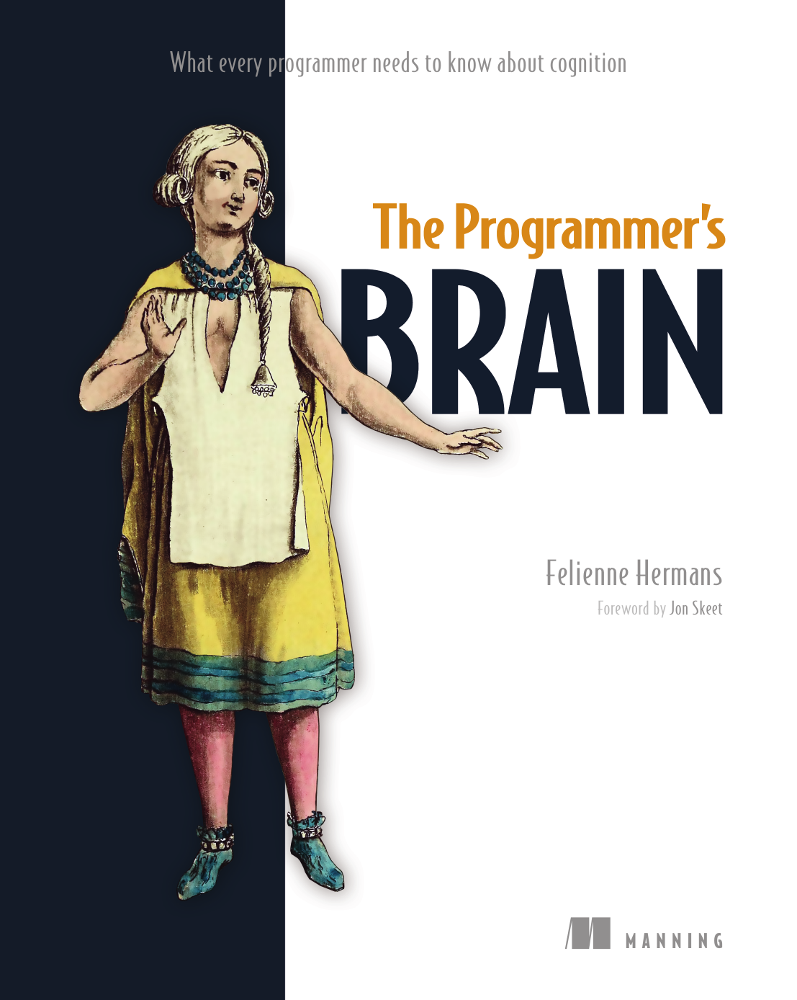

# The Programmer's Brain

What every programmer needs to know about cognition

by **Felienne Hermans** · Manning, 2021

Presentation: Christopher Schnelling

<!--
Welcome.

Today: a book that is about programming,
but not about any language, framework or architecture.

It is about the thing we all use every day and almost never think about: our brain.

The author Felienne Hermans was an associate professor at Leiden University when she wrote the book.
She researches how people learn and teach programming.
The book translates cognitive science into practical techniques for programmers.

Plan: quick warm-up exercise,
where the book sits, the core model,
then a tour through the four parts, with an "AI lens" along the way.

About 25 minutes, questions at the end.
-->

---

<!-- _class: exercise dense -->

## Warm-up: what does this code do?

All three convert a number `n` to binary.

```apl
2 2 2 2 2 ⊤ n
```

```java
public class BinaryCalculator {
    public static void main(Integer n) {
        System.out.println(Integer.toBinaryString(n));
    }
}
```

```basic
1 LET N2 = ABS (INT (N))
2 LET B$ = ""
3 FOR N1 = N2 TO 0 STEP 0
4     LET N2 = INT (N1 / 2)
5     LET B$ = STR$ (N1 - N2 * 2) + B$
6     LET N1 = N2
7 NEXT N1
8 PRINT B$
9 RETURN
```

<!--
EXERCISE (~45 seconds). This is the opening of chapter 1.

"Take 30 seconds. Look at each snippet. Don't just ask whether you understand it, ask HOW it feels to be confused by each one. Is it the same kind of confusion?"

Let them look. Ask 1-2 people: "Which one was the most annoying, and why?"

Typical answers: APL - "I have no idea what that T operator is". Java - "I know what it does, but how does toBinaryString work inside? What about negative numbers?". BASIC - "I can read every line, but I have to simulate it in my head".

Transition: these are three DIFFERENT kinds of confusion, and they map to three different cognitive systems.
-->

---

## Three kinds of confusion

| Code | Confusion | Missing… | Memory system |
|---|---|---|---|
| APL `⊤` | What *is* this operator? | **knowledge** | Long-term memory (LTM) |
| Java `toBinaryString` | What does it do *inside*? | **information** | Short-term memory (STM) |
| BASIC loop | Where am I? What is `N1` now? | **processing power** | Working memory (WM) |

Naming *which* confusion you have tells you *what* to do about it.

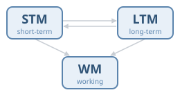

<!--
APL: you lack knowledge. The meaning of the operator is not in your long-term memory. No amount of staring will help; you need to look it up / learn it.

Java: you have the knowledge, but the information is not available. It's hidden behind a method call. You'd need to navigate to it, and keep it in short-term memory.

BASIC: everything is there and every keyword is familiar, but you lack processing power. You have to track several variables at once; that's working memory.

This is the backbone of the whole book, and of this talk. The little diagram in the bottom left will follow us through the talk and show which system each topic is about.
-->

---

<!-- _class: covers -->


## Where does this book sit?

**Language & craft** — *how* to write idiomatic code in some language
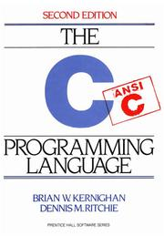 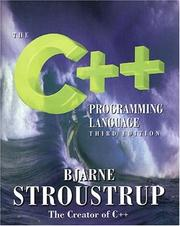 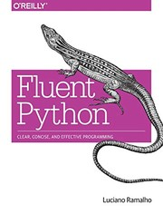 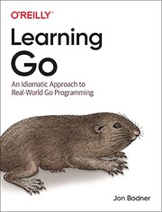

**Architecture & design** — *how* to structure systems
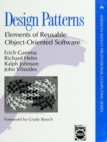 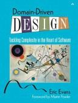  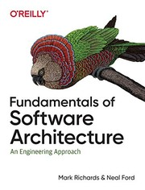

**The "philosophical" shelf** — *why* software is hard for humans
  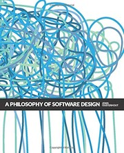 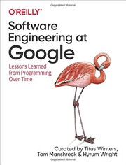

<small>Books: [1]–[12]</small>

<!--
Most of our bookshelves look like this.

Top pile: language books. Narrow and deep. Great for learning a tool, they age with the tool.

Middle pile: architecture and design. How to structure systems. Patterns, domain modelling (Evans' DDD), services, architecture trade-offs.

Bottom pile: the "philosophical" shelf. Books about why software is hard for people, not for machines. Brooks: adding people to a late project makes it later. Ousterhout: complexity is anything that makes a system hard to understand and modify. SWE at Google: software engineering is programming integrated over time. And Clean Code, at the bottom of the pile, which tells you very confidently WHAT to do. (Light jab: some of it has aged; the evidence behind it is thin.)

The Programmer's Brain belongs on this third shelf, but it brings something none of the others have: evidence from cognitive science. It explains WHY some of the advice on that shelf works. For example, Ousterhout's "complexity" is essentially what this book calls cognitive load.
-->

---

## Why this book, why now?

- Developers spend **~58–60 %** of their time **understanding** code, not writing it [13]
- Yet we *train* writing (katas, LeetCode, courses) and almost never *train* reading
- The book is about the human side: memory, load, names, interruptions, onboarding

> **AI lens:** AI assistants write more and more code. Our job shifts from *writing* to **reading, reviewing and judging** code we did not write. The bottleneck is no longer typing. It is understanding.

<!--
The 58-60% number is quoted twice in the book (chapters 2 and 5), from a field study of professional developers by Xia et al. [13].

Point out the asymmetry: we practice writing, we rarely practice reading. Donald Knuth is the notable exception in Seibel's "Coders at Work" interviews [14]: most interviewees said reading code is important, but few could name code they had recently read.

AI LENS (this is MY interpretation, the book is from 2021 and does not discuss LLMs): with AI-assisted development, the ratio shifts even further toward reading. Every AI suggestion, every agent-generated PR is code you didn't write, from an "author" whose intent you can't ask about. So getting better at reading code is now more valuable than ever.

I'll come back to this with a short "AI lens" box on several slides.
-->

---

## The model behind the whole book

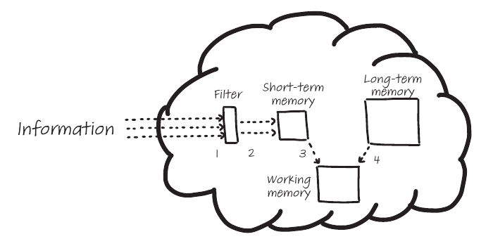

- **Short-term memory (STM):** holds what you just read. Only **~2–6 items**, for seconds [15, 16]
- **Long-term memory (LTM):** keywords, idioms, patterns, domain knowledge. Huge, but slow to fill
- **Working memory (WM):** where thinking happens. Tracing, deciding, combining
- All three work **together** on every line


<!--
Figure 1.2 from the book. Information comes in through a filter, lands in short-term memory, and working memory combines it with what long-term memory retrieves.

Key number: STM holds about 2-6 items. That's tiny. Miller's famous "seven plus or minus two" [15] has been revised downward by later research [16]. Compare to the number of variables, calls and types in a typical method.

Everything else in the book follows from these limitations:
- STM is small -> chunking, focus
- LTM needs deliberate training -> flashcards, spaced repetition, worked examples
- WM gets overloaded -> cognitive load, refactoring, diagrams, state tables

From now on, the diagram in the corner tells you which part we're talking about.
-->

---

<!-- _class: bigtable -->

## The book at a glance

| Part | Chapters |
|---|---|
| **1 · Reading code better** | Confusion · Speed reading · Learning syntax · Complex code |
| **2 · Thinking about code** | Roles of variables · Mental models · Misconceptions |
| **3 · Writing better code** | Naming · Code smells & cognitive load · Problem solving |
| **4 · Collaborating on code** | Interruptions · Designing larger systems · Onboarding |

13 chapters, ~220 pages, **every chapter has exercises** you can do on your own code.

<!--
Structure of the book. It moves from the individual (how do I read one piece of code) to the team (how do we design codebases and onboard people).

Each chapter ends with exercises you can do on your own codebase, which is what makes the book practical rather than just interesting.

I'll go through it in that order, but I'll skip or merge some chapters.
-->

---

<!-- _class: lead -->

# Part 1
## Reading code better

---

## Chunking: why experts "see" more code

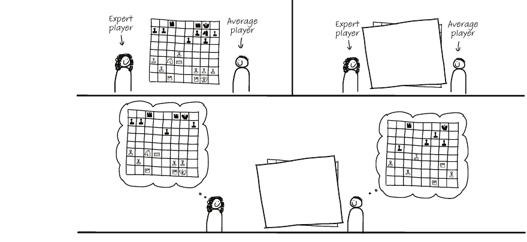

- **De Groot (chess)** [17]: masters recall real positions far better than average players, but **not random** ones
- **McKeithen (ALGOL)** [18]: same for programmers: experts win on real code, **not on scrambled code**
- Experts don't have a bigger STM. They store **chunks** ("a for-loop", "a VWAP calculation") instead of characters

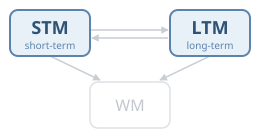

<!--
Chapter 2. The chess story: Adriaan de Groot showed a chess position for a few seconds. Masters could recreate it much better than average players. But when the pieces were placed randomly, masters were no better.

So the masters don't have a better memory. They recognize patterns ("Sicilian opening") stored in long-term memory, and one pattern takes one slot in STM.

Katherine McKeithen repeated this with programmers and ALGOL programs in 1981: same result. Experts recall much more of regular programs, but scrambled programs level the playing field.

Implication: reading speed depends on how many chunks you have in long-term memory. You can't "focus harder" to get a bigger STM; you can only get better chunks.
-->

---

<!-- _class: exercise bigcode -->

## Try it: 20 seconds, then write it down

```python
def vwap(trades):
    total_value = 0.0
    total_volume = 0
    for price, qty in trades:
        total_value += price * qty
        total_volume += qty
    return total_value / total_volume if total_volume else None
```

<!--
EXERCISE (~1.5 minutes). Adapted from the exercise in chapter 2.

"You have 20 seconds to memorize this. Then I'll switch the slide and you write it down as accurately as you can."

Time 20 seconds, then go to the next slide.
-->

---

<!-- _class: exercise -->

## Now write it down. What did you remember, and *how*?

- Did you remember characters, or **"it's a VWAP; a sum and a count; guard against zero"**?
- Where did you struggle? That's where your chunks are missing
- Did anyone notice that money is stored in a **float**? (we'll come back to that…)

<!--
Give them ~45 seconds to write.

Then ask: who got it almost right? How did you remember it?

Most people in this room will have chunked it as "VWAP" (domain chunk), "accumulate in a loop" (programming chunk), and "division-by-zero guard" (idiom). Someone new to finance would have to remember the characters.

The book's point: what you remember reveals what you already know. You can use this as a self-diagnosis tool on unfamiliar code: copy what you remember, and compare.

The float remark is a hook for the misconceptions slide later.
-->

---

## What makes code easy to chunk?

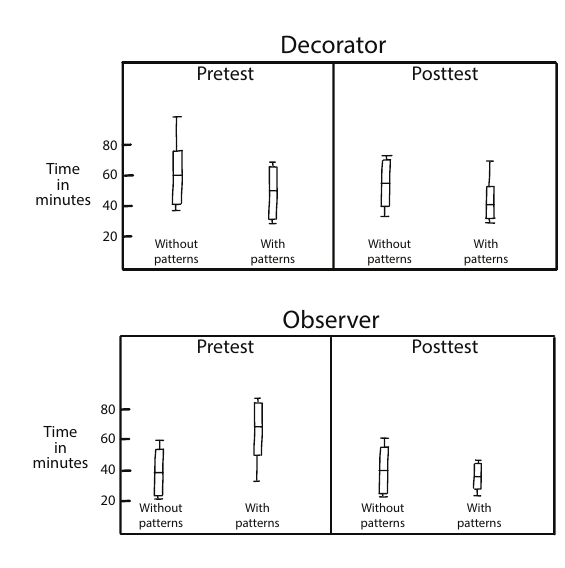

- **Design patterns** [19]: faster maintenance *with* patterns, once people knew them
- **Comments**, especially high-level ones
- **Beacons** [20]: recognizable markers (`swap`, `tmp`) that confirm a hypothesis

> **AI lens:** chunks come from working with lots of code. If AI writes most of it, where do the next generation's chunks come from?


<!--
Figure 2.7: Walter Tichy's study. Two tasks (Decorator, Observer). After a course on design patterns, people modified code that contained patterns faster. Patterns are shared chunks.

Beacons: parts of code that serve as an indicator of what the code does. E.g. a variable called "swap", or a recognizable idiom. They confirm or refute your hypothesis.

Also from chapter 2: you see more code than you can read. Iconic memory takes in a whole screen, but only a small part makes it into STM.

AI LENS (my extrapolation, not from the book): chunking depends on a well-stocked long-term memory, which you build by working with code. If juniors mostly accept AI suggestions, they might read code without ever building the chunks that make reading fast. Something to discuss, not a conclusion.
-->

---

## Learning syntax still matters

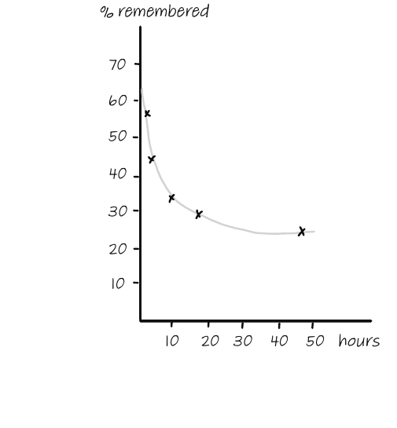

- "Just look it up" has a cost: every lookup is an **interruption**, and missing syntax blocks chunking
- **Forgetting curve** [21, 22]: half gone after ~1 hour, ~25 % left after 2 days
- **Spaced repetition** [23] and **retrieval practice** (try to recall *before* looking up)
- **Elaboration:** connect new facts to what you already know

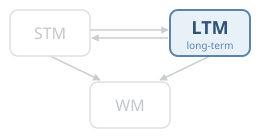

<!--
Chapter 3. Slightly controversial for a senior audience: "we don't need to memorize syntax, we can google it". The book argues against that. First, looking things up interrupts you (and chapter 11 shows interruptions are expensive). Second, if you lack syntax knowledge, you can't chunk, so reading is slower.

Forgetting curve (Ebbinghaus): after an hour, about half of what you read is gone; after two days, about a quarter remains.

Techniques: flashcards with spaced repetition (Anki etc.), and retrieval practice: actively try to remember before looking it up. Elaboration: when learning something new, actively think about related things you know.

Practical: if you're learning a new language (Go, Rust, ...), keep a small deck of the constructs you keep looking up.

OPTIONAL SLIDE: skip if short on time.
-->

---

## Complex code: cognitive load

- Working memory has a limit. **Cognitive load** = how much of it a task uses [24]
- **Intrinsic load:** the problem itself is hard (a matching engine *is* complex)
- **Extraneous load:** how it is presented, or what the reader doesn't know yet
- Only extraneous load can be reduced
  - **Refactor for the reader:** inline a helper, replace an unfamiliar construct (e.g., lambda → loop)
  - It may be **temporary**: a local "cognitive refactoring" just to understand, then revert

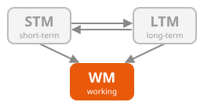

<!--
Chapter 4. Cognitive load theory (Sweller): intrinsic vs extraneous load. Intrinsic is the inherent complexity. Extraneous is added: by the way the code is written, or because the reader lacks knowledge.

Important nuance: extraneous load depends on the READER. A list comprehension is zero extraneous load for a Pythonista, but high for someone from Java 7. So "readable" is not a property of code alone, but of code + reader.

Cognitive refactoring: a refactoring done to understand, not to improve. E.g. inline methods so you see everything in one place, even though that's the opposite of what Clean Code tells you. You can throw it away afterwards.

Connection to Ousterhout: his "deep modules" reduce the load for the caller.
-->

---

## When working memory overflows: write it down

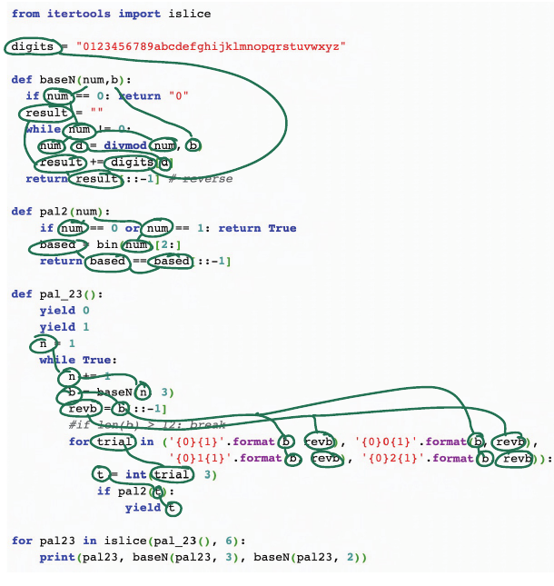

**Dependency graph** (right): circle variables, link their uses, link calls to definitions

**State table:** one column per variable, one row per step. The BASIC program for `N = 7`:

| Step | N2 | B$ | N1 |
|---|---|---|---|
| init | 7 | `""` | 7 |
| loop 1 | 3 | `"1"` | 3 |
| loop 2 | 1 | `"11"` | 1 |
| loop 3 | 0 | `"111"` | 0 |


<!--
Two concrete tools from chapter 4 for when the code is too much for your working memory.

Right: dependency graph. Print the code (yes, on paper), circle all variables, link them to their other occurrences, circle method calls and link them to definitions. The structure of the code becomes visible.

Table: state table for the BASIC program from the warm-up (the book's figure 4.7 does the same). One column per variable, one row per iteration. Tedious, but it moves the work from your working memory to paper.

These sound basic, but we do them all the time in our heads, badly. In debugging sessions, a shared state table on a whiteboard is very effective.

AI LENS: these are also good things to ask an assistant for. "Draw the call graph" / "trace the values". But verify; it's your working memory being supported, not replaced.
-->

---

<!-- _class: lead -->

# Part 2
## Thinking about code

---

## Deeper understanding: roles and plans

- **Roles of variables** [25]: 11 roles cover almost all variables
  - *fixed value, stepper, flag, walker, most-recent holder, most-wanted holder, gatherer, container, follower, organizer, temporary*
  - The `vwap` example: two **gatherers**, a **stepper** over trades
- **Text knowledge vs. plan knowledge** [26]
  - *Text:* what each line does (syntax)
  - *Plan:* **why** it's there, what the author intended

> **AI lens:** reviewing AI-generated code gives you all the text and none of the plan. The author can't tell you why.

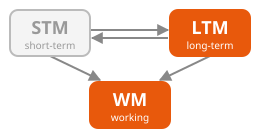

<!--
Chapter 5. Roles of variables: Jorma Sajaniemi's framework. Annotate variables with their role while reading (the book suggests small icons). It gives you a vocabulary that is above syntax. In our VWAP example: total_value and total_volume are gatherers, price/qty are most-recent holders from a stepper.

Text structure knowledge vs plan knowledge (Nancy Pennington): you can understand every line and still not understand the program. Plan knowledge is understanding the goals and intentions.

AI LENS: this is the crux of AI code review. A human author has a plan you can ask about. With generated code, there may not BE a coherent plan. You have to reconstruct one, or decide there isn't one. That's harder than reviewing a colleague's PR, not easier.
-->

---

## Reading code is like reading text

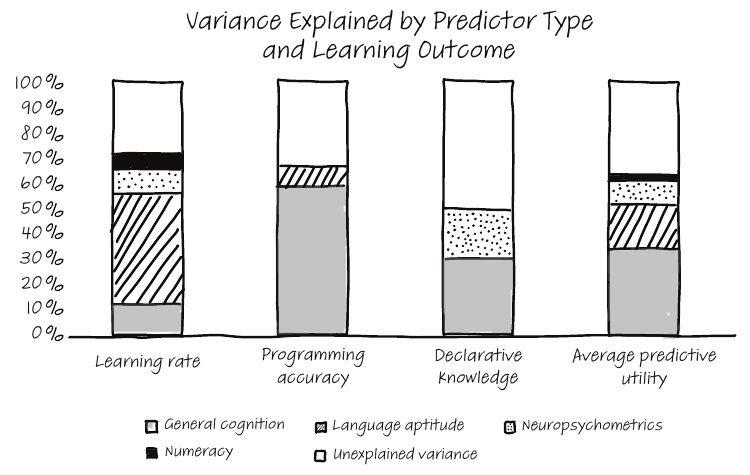

- **Prat et al.** [27]: what predicts how fast people learn to program?
  - Numeracy: **2 %** · Language aptitude: **17 %** · Working memory & reasoning: **34 %**
- So use **reading strategies** on code:
  - activate prior knowledge · monitor · find key lines
  - infer meaning from names · visualize · **question** · **summarize**


<!--
Surprising result from Chantal Prat et al. (2020): mathematical ability explains only 2% of the variance in how fast people learn Python. Language aptitude explains 17%. General working memory and reasoning 34%.

So programming is closer to language than we usually think. And we can borrow strategies from text comprehension research, which is very mature (we teach every child to read).

The seven strategies: activate prior knowledge, monitor (track what you do/don't understand), determine importance of lines, infer meaning of names, visualize, question, summarize.

Practical: try summarizing a class in 2-3 sentences before modifying it. It's also a great onboarding task (later).

AI LENS: an AI summary can be useful, but the learning effect comes from producing the summary yourself. Do it first, then compare with the AI.
-->

---

## Mental models & notional machines

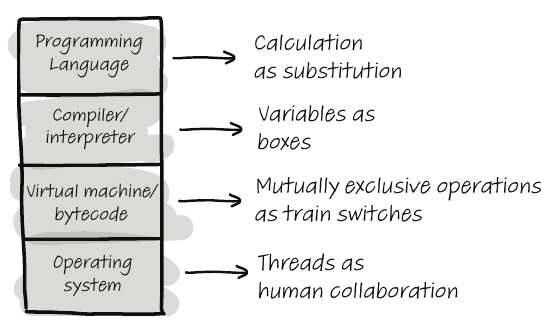

- How you **represent** a problem shapes how you solve it
- **Mental models** [28]: simplified internal models. We often hold several, and they compete
- **Notional machines** [29]: deliberate abstractions of the computer ("a variable is a box")
  - useful, but every one is wrong somewhere: a box holds *one* thing; a variable can alias


<!--
Chapter 6. Mental models: everybody has a simplified model of how e.g. a database transaction, a Kafka partition, or Kubernetes reconciliation works. These models are useful and always incomplete.

Notional machines: explanations at different levels of abstraction, see figure 6.4: "variables as boxes", "threads as human collaboration", etc.

Point: when two people disagree in a design discussion, they often have different mental models. Making the model explicit (draw it!) helps more than arguing about the code.

For DevOps: "the cluster is a set of servers" vs "the cluster is a desired-state reconciliation loop". Both models are useful, but they lead to different debugging strategies.

OPTIONAL: can be merged into the next slide if short on time.
-->

---

## Misconceptions: bugs in your thinking

- Prior knowledge **transfers**: positively (a 2nd language is easier) and **negatively**
- A **misconception** is a belief that is
  - **faulty**, held **consistently**, held with **confidence**
- Telling someone they're wrong rarely works. It requires **conceptual change**, and old models resurface under stress
- Defenses: **tests** and **documentation** that make wrong assumptions fail loudly

Examples: *"money fits in a float"* · *"Python variables are typed like Java's"* · *"this retry is idempotent"*

> **AI lens:** an LLM hallucinating an API is a misconception with perfect confidence, and it can *transfer* into your head.


<!--
Chapter 7. Transfer: knowing Java helps you learn C#. But knowledge can also transfer negatively: e.g. Java developers in Python relying on types to make decisions.

Misconception, formally: faulty, consistent across situations, and held with confidence. The book's example: "chili seeds are the spiciest part" (they are not).

Key insight: you can't fix a misconception by pointing out the error. The old model needs to be replaced by a new one (conceptual change), and the old one can come back, especially under time pressure.

Callback to the VWAP exercise: did anyone flag the float? "Money fits in a float" is a classic misconception in our domain.

Defenses in the codebase: tests that encode the correct model, and documentation that explicitly names known misconceptions ("note: this is NOT idempotent").

AI LENS: LLMs produce plausible, confident, consistent wrong answers, which fits the definition of a misconception, and they can transfer to the reader.
-->

---

<!-- _class: lead -->

# Part 3
## Writing better code

---

## Naming things

- Identifiers make up **~33 % of tokens** and **~72 % of characters** in code [30]
- Ask two developers to name the same thing → same name only **~7 %** of the time [31]
- Bad names correlate with **more bugs** (correlation, not proven causation) [32]
- Pick a few **name molds** (`max_rate` vs `rate_max`) and stick to them
- **Feitelson's 3 steps** [31]:
  1. choose the **concepts** to include
  2. choose the **words** for each concept
  3. **combine** them using the team's molds


<!--
Chapter 8. Names are the main way code communicates intent. Most of the characters you read are names.

Dror Feitelson's study: when two people independently name the same thing, the median probability that they pick the same name is only 7%. So naming is hard and highly variable.

Snake vs camel case: there are studies on that too [33] (camel case is easier to remember, snake case is faster to recognize). But consistency matters more than the choice.

Name molds: the patterns in which words are combined. Limit your codebase to a few.

Feitelson's 3-step model: 1) which concepts belong in the name, 2) which words for each concept, 3) how to combine them. In an experiment, names made this way were rated better.

For us: domain vocabulary is a big part of step 2: "notional", "exposure", "position", "settlement". A team glossary helps.
-->

---

## Linguistic antipatterns: when names lie

```java
boolean isSettled(Trade t);          // actually returns a SettlementStatus
Price   getPrice(String isin);       // does a blocking remote call
void    setNotional(BigDecimal n);   // also recalculates margin...
```

- **Arnaoudova** [34]: in open-source code, **64 %** of identifiers starting with `is` were **not booleans**; **11 %** of setters also return a value
- Lying names put **wrong facts** into your LTM and lead to **wrong chunks**
- **Code smells** [35] (long methods, long parameter lists, duplicated code) map to the same memory limits

> **AI lens:** LLMs are very good at *plausible* names. Plausible is not the same as true. Check that the name matches the behaviour.


<!--
Chapter 9. Venera Arnaoudova defined linguistic antipatterns: places where the name, type or comment says something different from what the code does. Examples: "get" methods that do more than return a field, "is" that is not boolean, setters that return values.

The numbers are from 7 open source projects: 64% of "is" identifiers were not boolean, 11% of setters also return a value, and in 2.5% of methods the name and the comment say opposite things.

Measured in experiments: linguistic antipatterns increase cognitive load (the book describes fNIRS brain measurements). Your LTM retrieves the "usual meaning" of get/is/set and you build a wrong chunk.

Code smells: the chapter maps Fowler's code smells to cognitive limits. A long parameter list overloads working memory, and duplicated code with small differences breaks chunking.

AI LENS: generated code tends to have very conventional names, which is good for chunking but bad when the conventional name doesn't match the behavior. In review, check the names against what the code actually does.
-->

---

## Problem solving is not a generic skill

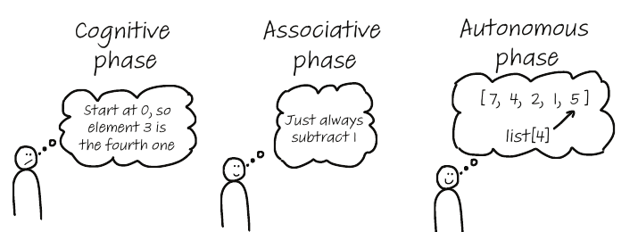

- **Domain knowledge**, not a "general problem-solving skill", makes people fast
- **Automatized skills** (typing, shortcuts, idioms) free working memory
- **Worked examples** [36]: study good code *with an explanation*
- **Germane load:** the effort of storing new knowledge

> **AI lens:** an AI explanation can be a worked example, if you actively process it.


<!--
Chapter 10. Sobering point for hiring: puzzles and generic problem-solving tests mostly measure prior knowledge of similar puzzles. Expertise is domain-specific.

Automatization (figure 10.4): cognitive -> associative -> autonomous phase. Once a skill is automatic it costs no working memory, which leaves capacity for the actual problem.

Worked examples (Sweller): novices learn more from studying solved examples with explanations than from solving problems themselves. That's counterintuitive for programmers who believe in "learning by doing".

Germane load: the third type of cognitive load. It's the effort your brain spends on storing new knowledge. If intrinsic and extraneous load use all your working memory, nothing gets learned.

AI LENS: an LLM explaining existing code works like a worked example on demand. But reading the explanation passively doesn't create much learning. Germane load requires effort.

OPTIONAL SLIDE.
-->

---

<!-- _class: lead -->

# Part 4
## Collaborating on code

---

## Five programming activities

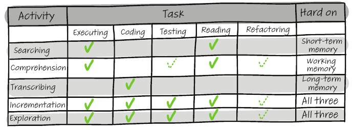

Different activities load **different** memory systems, so they need **different support** [37].


<!--
Chapter 11, based on the Cognitive Dimensions framework (Green, Blackwell, Petre).

- Searching: looking for a location. Hard on STM; take notes about where you've been.
- Comprehension: understanding. Hard on working memory.
- Transcription: implementing a known plan. Hard on LTM (syntax knowledge).
- Incrementation: adding a feature, which is a mix of all three.
- Exploration: sketching, prototyping. Also all three.

Debugging is not a separate activity; it's a combination of these.

Practical: when you plan your day, or a ticket, it helps to know which activity you're in. And when reviewing, "I'm searching" vs "I'm comprehending" need different tools.
-->

---

## Programmer, interrupted

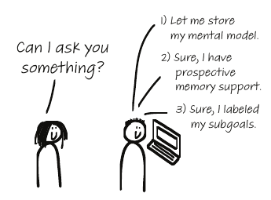

- **~15 min** to resume editing after an interruption [38]
- Typically **one uninterrupted 2-hour session per day** [38]
- Defenses:
  - **Brain-dump** your mental model
  - **Prospective memory:** `TODO`s, failing tests
  - **Label subgoals**; interrupt at **low-load** moments

> **AI lens:** agents asking for confirmation every few minutes are interruptions too.


<!--
Chris Parnin recorded 10,000 programming sessions from 86 programmers. After an interruption, it takes about a quarter of an hour to get back to editing code. When interrupted during an edit, people resumed in under a minute only 10% of the time. The average programmer gets just one uninterrupted two-hour session a day. Earlier, van Solingen found interruptions take 15-20 minutes each and eat about 20% of a developer's time [39]. A Microsoft study: 62% of developers consider recovering from interruptions a serious problem [40].

Why: working memory loses the mental model of the code, and it has to be rebuilt.

Three defenses (figure 11.2):
1. Store your mental model: write down your current understanding before you switch.
2. Prospective memory: "remembering to remember". TODO comments, deliberately failing tests.
3. Subgoal labeling: break the task into labeled steps so you can find your place again.

FlowLight (a traffic light on the desk showing whether you're interruptible) reduced interruptions by 46% [41]. Slack status can do the same.

DEVOPS / ON-CALL: incident response is pure interruption. Runbooks are external memory for exactly this situation.

AI LENS: agentic workflows can fragment attention: start the agent, switch away, come back. Each switch costs you. Consider batching agent interactions.
-->

---

## Cognitive dimensions of codebases (CDCB)

A shared vocabulary for design trade-offs [37]. A selection:

| Dimension | Question | Our world |
|---|---|---|
| **Hidden dependencies** | Can I see what depends on what? | events, Helm values, config wiring |
| **Viscosity** | How hard is a change? | one field → 12 files, 3 repos |
| **Error-proneness** | How easy is it to get wrong? | `double` for money, unit-less numbers |
| **Consistency** | Are similar things similar? | five ways to call a REST service |
| **Progressive evaluation** | Can I run half-finished work? | local env, REPL, partial pipelines |
| **Closeness of mapping** | Does code speak the domain? | `Order`, `Fill` vs `Record`, `Handler` |

Improving one dimension often hurts another → **design maneuvers**


<!--
Chapter 12. The Cognitive Dimensions of Notations framework comes from HCI research on programming languages. Hermans adapts it to codebases: CDCB.

It gives you words for design discussions. Instead of "this is ugly", say "this has high viscosity: one change touches 12 files" or "this has many hidden dependencies: config-driven wiring nobody can see from the code".

Some dimensions that matter for us:
- Hidden dependencies: event-driven systems, YAML-configured pipelines, Helm values: the dependency isn't visible where it's used. Very relevant for DevOps people.
- Closeness of mapping: does the code use the language of the market (orders, fills, positions), or generic "records" and "handlers"? This is the cognitive argument for DDD.
- Progressive evaluation: can you run half a pipeline? Local dev environments, REPLs, notebooks.

The book also has a table (12.1) mapping which dimensions help or hurt which of the five activities. Other dimensions not shown: diffuseness, provisionality, role-expressiveness, secondary notation, abstraction, hard mental operations. Design maneuver: deliberately change one dimension, accepting a trade-off in another (e.g. more diffuse but less error-prone).
-->

---

## Onboarding: experts forget what it's like

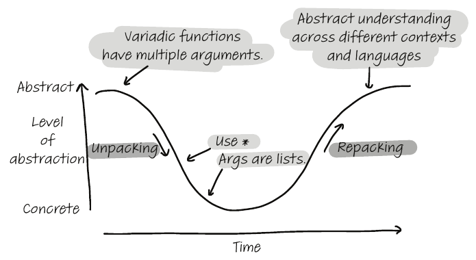

- Experts think **abstractly**; novices cling to **concrete** details
- Even seniors fall back to novice mode in unfamiliar code
- Explain along a **semantic wave** [42]: abstract → concrete → back to abstract


<!--
Chapter 13. The "curse of knowledge": experts don't remember what was hard.

Novices focus on details and have a hard time stepping back. Midlevel and senior developers temporarily fall back to that behaviour when they are new to a codebase or language.

Semantic wave (Maton): good explanations start abstract, go down to concrete examples ("unpacking"), and back up to the abstract ("repacking"). Anti-patterns (figure 13.3): staying abstract (high flatline), staying concrete (low flatline), or going down without coming back up.
-->

---

## Onboarding in practice

- **One activity at a time:** "summarize this class", not "read, explore *and* implement"
- Support all three memories:
  - **LTM:** glossary of domain concepts, list of libraries & frameworks
  - **STM:** small, focused tasks
  - **WM:** diagrams, tables
- **Read code together** (code reading clubs)

> **AI lens:** `AGENTS.md` / context files are onboarding docs for a newcomer with *no* long-term memory. Good onboarding docs serve both.


<!--
Typical bad onboarding: the lead clicks through the code explaining everything while the newcomer tries to read, search and understand at the same time, which is guaranteed overload. Better: give one activity at a time. E.g. "write a summary of this class" (comprehension only). The summaries are useful documentation for the next newcomer.

Support memory:
- LTM: list of domain concepts and of libraries/frameworks used
- STM: small, focused tasks
- WM: diagrams, tables

Code reading clubs (the first one was started by Katja Mordaunt): a group reads unfamiliar code together using exercises like the ones in the book. The book suggests starting one at work.

AI LENS: an AI agent is the ultimate newcomer. It has no long-term memory of your system at all. The same things that help human onboarding (glossary, architecture overview, conventions, one focused task at a time) help agents. Writing them once serves both.
-->

---

## The AI lens, summarized

| Book concept | What changes with AI-assisted development |
|---|---|
| ~60 % of time understanding code | …and rising: **review** is the main job |
| Chunking needs LTM | Do we still **build** the chunks if we stop writing? |
| Text vs plan knowledge | Generated code has text, but **no author to ask** for the plan |
| Linguistic antipatterns | **Plausible** names ≠ **true** names |
| Misconceptions | Confident, consistent, faulty, now at scale |
| Interruptions | Agent loops fragment flow |
| Onboarding | Context files = onboarding for a newcomer with no LTM |

<small>The book (2021) predates LLM coding tools. These are my extrapolations.</small>

<!--
Recap of the AI thread. Be explicit: this is my reading of the book; Felienne doesn't make these claims.

Main idea: AI does not remove the need to understand code. It moves more of our time to understanding, and it removes some of the ways we used to build understanding (writing the code ourselves). So the techniques in this book become more important.

Potential discussion question for Q&A: "How do we make sure juniors still build chunks?"
-->

---

<!-- _class: big -->

## Five things to try on Monday

1. **Name your confusion:** knowledge, information, or processing power? Then pick the right tool
2. **Refactor to understand**, even if you throw the refactoring away
3. **Brain-dump before you switch**, and protect two-hour blocks
4. **Hunt for lying names** in your next review (`is…`, `get…`, `set…`)
5. **Onboard with one activity at a time**, and write the glossary you wish you had

<!--
Concrete, small, actionable. Read them out, one sentence each.

If people only remember one: number 1. Knowing which kind of confusion you have tells you what to do about it.
-->

---

<!-- _class: lead -->
<!-- _paginate: false -->


## Why read it?

Short, practical, evidence-based, with **exercises on your own code**

*"Confusion is part of programming."*

Questions?

<small>Figures taken from the book. References and sources: see backup.</small>

<!--
Why read it: it's short (~220 pages), each chapter is self-contained, and you can apply the exercises directly to your codebase. It gives you vocabulary (cognitive load, chunks, linguistic antipatterns, viscosity) that makes team discussions more precise.

Closing thought from the book: confusion is normal and is part of programming. The goal isn't to never be confused. It's to recognize what kind of confusion you have, and to know what to do about it.

Thank you. Questions?
-->

---

<!-- _class: lead -->
<!-- _paginate: false -->

# Backup
## References

---

<!-- _class: refs -->

## References (1/3): the bookshelf

- [1] B. W. Kernighan, D. M. Ritchie. *The C Programming Language*. Prentice Hall, 1978.
- [2] B. Stroustrup. *The C++ Programming Language*. Addison-Wesley, 1986.
- [3] L. Ramalho. *Fluent Python*. O'Reilly, 2015.
- [4] J. Bodner. *Learning Go*. O'Reilly, 2021.
- [5] E. Gamma, R. Helm, R. Johnson, J. Vlissides. *Design Patterns: Elements of Reusable Object-Oriented Software*. Addison-Wesley, 1994.
- [6] E. Evans. *Domain-Driven Design: Tackling Complexity in the Heart of Software*. Addison-Wesley, 2003.
- [7] S. Newman. *Building Microservices*. O'Reilly, 2015.
- [8] M. Richards, N. Ford. *Fundamentals of Software Architecture*. O'Reilly, 2020.
- [9] R. C. Martin. *Clean Code: A Handbook of Agile Software Craftsmanship*. Prentice Hall, 2008.
- [10] F. P. Brooks Jr. *The Mythical Man-Month*. Addison-Wesley, 1975.
- [11] J. Ousterhout. *A Philosophy of Software Design*. Yaknyam Press, 2018.
- [12] T. Winters, T. Manshreck, H. Wright. *Software Engineering at Google*. O'Reilly, 2020.
- [13] X. Xia et al. "Measuring Program Comprehension: A Large-Scale Field Study with Professionals." *IEEE TSE* 44(10), 2018.
- [14] P. Seibel. *Coders at Work*. Apress, 2009.

<small>Cover images: Open Library (openlibrary.org).</small>

---

<!-- _class: refs -->

## References (2/3): reading and thinking about code

- [15] G. A. Miller. "The Magical Number Seven, Plus or Minus Two." *Psychological Review* 63(2), 1956.
- [16] N. Cowan. "The Magical Number 4 in Short-Term Memory." *Behavioral and Brain Sciences* 24(1), 2001.
- [17] A. D. de Groot. *Thought and Choice in Chess*. Mouton, 1965 (Dutch original 1946).
- [18] K. B. McKeithen, J. S. Reitman, H. H. Rueter, S. C. Hirtle. "Knowledge Organization and Skill Differences in Computer Programmers." *Cognitive Psychology* 13(3), 1981.
- [19] L. Prechelt, B. Unger, W. F. Tichy. "Two Controlled Experiments Assessing the Usefulness of Design Pattern Information During Program Maintenance." *Empirical Software Engineering*, 1998.
- [20] M. E. Crosby, J. Scholtz, S. Wiedenbeck. "The Roles Beacons Play in Comprehension for Novice and Expert Programmers." *PPIG*, 2002.
- [21] H. Ebbinghaus. *Über das Gedächtnis*. 1885.
- [22] J. M. J. Murre, J. Dros. "Replication and Analysis of Ebbinghaus' Forgetting Curve." *PLOS ONE* 10(7), 2015.
- [23] H. P. Bahrick et al. "Maintenance of Foreign Language Vocabulary and the Spacing Effect." *Psychological Science* 4(5), 1993.
- [24] J. Sweller. "Cognitive Load During Problem Solving: Effects on Learning." *Cognitive Science* 12(2), 1988.
- [25] J. Sajaniemi, M. Kuittinen. "An Experiment on Using Roles of Variables in Teaching Introductory Programming." *Computer Science Education* 15(1), 2005.
- [26] N. Pennington. "Stimulus Structures and Mental Representations in Expert Comprehension of Computer Programs." *Cognitive Psychology* 19(3), 1987.
- [27] C. S. Prat et al. "Relating Natural Language Aptitude to Individual Differences in Learning Programming Languages." *Scientific Reports* 10, 2020.
- [28] K. Craik. *The Nature of Explanation*. Cambridge University Press, 1943.
- [29] B. du Boulay. "Some Difficulties of Learning to Program." *Journal of Educational Computing Research* 2(1), 1986.

---

<!-- _class: refs -->

## References (3/3): writing and collaborating

- [30] F. Deißenböck, M. Pizka. "Concise and Consistent Naming." *IWPC*, 2005.
- [31] D. G. Feitelson et al. "How Developers Choose Names." *IEEE TSE* 48(1), 2022.
- [32] S. Butler, M. Wermelinger, Y. Yu, H. Sharp. "Relating Identifier Naming Flaws and Code Quality: An Empirical Study." *WCRE*, 2009.
- [33] D. Binkley, M. Davis, D. Lawrie, C. Morrell. "To CamelCase or Under_score." *ICPC*, 2009.
- [34] V. Arnaoudova, M. Di Penta, G. Antoniol. "Linguistic Antipatterns: What They Are and How Developers Perceive Them." *Empirical Software Engineering* 21(1), 2016.
- [35] M. Fowler. *Refactoring: Improving the Design of Existing Code*. Addison-Wesley, 1999.
- [36] J. Sweller, G. A. Cooper. "The Use of Worked Examples as a Substitute for Problem Solving in Learning Algebra." *Cognition and Instruction* 2(1), 1985.
- [37] T. R. G. Green, M. Petre. "Usability Analysis of Visual Programming Environments: A 'Cognitive Dimensions' Framework." *Journal of Visual Languages & Computing* 7(2), 1996.
- [38] C. Parnin, S. Rugaber. "Resumption Strategies for Interrupted Programming Tasks." *Software Quality Journal* 19(1), 2011.
- [39] R. van Solingen, E. Berghout, F. van Latum. "Interrupts: Just a Minute Never Is." *IEEE Software* 15(5), 1998.
- [40] T. D. LaToza, G. Venolia, R. DeLine. "Maintaining Mental Models: A Study of Developer Work Habits." *ICSE*, 2006.
- [41] M. Züger et al. "Reducing Interruptions at Work: A Large-Scale Field Study of FlowLight." *CHI*, 2017.
- [42] K. Maton. "Making Semantic Waves: A Key to Cumulative Knowledge-Building." *Linguistics and Education* 24(1), 2013.
